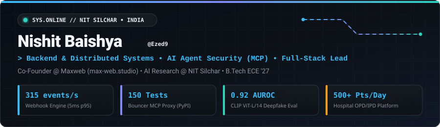
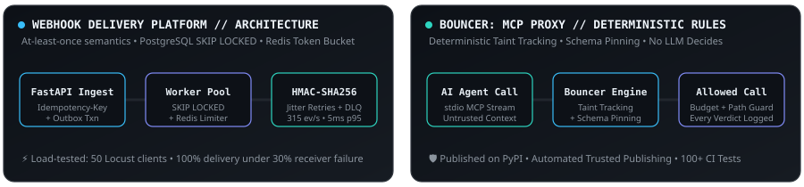

<div align="center">

<!-- Animated Custom Hero Banner -->


<br />

<!-- Animated Typing Header -->
<a href="https://github.com/Ezed9">
  
</a>

<br />

<!-- Contact & Profile Badges -->
<p align="center">
  <a href="https://max-web.studio">
    
  </a>
  <a href="mailto:nishitbaishya9@gmail.com">
    
  </a>
  <a href="https://www.linkedin.com/in/nishit-baishya/">
    
  </a>
</p>

</div>


## ⚡ `whoami` // Systems & AI Engineering

```yaml
engineer:
  name: "Nishit Baishya"
  handle: "@Ezed9"
  education: "B.Tech in Electronics & Communication Engineering @ NIT Silchar (2023–2027)"
  location: "Assam, India"

current_focus:
  - "Co-Founder & Full-Stack Lead @ Maxweb (max-web.studio) — Production Healthcare & B2B Systems"
  - "Deterministic AI Agent Security & Model Context Protocol (MCP) Guardrails"
  - "High-Throughput Distributed Queues, Transactional Outboxes & Rate-Limited Worker Pools"
  - "Generalizable Multimodal Representation Learning (CLIP ViT-L/14 Synthetic Media Detection)"
```


## 🏗️ Live System Architecture // Flagship Projects

<div align="center">
  
</div>

<br />

<table>
  <tr>
    <td width="50%" valign="top">
      <h3>🛡️ <a href="https://github.com/Ezed9">Bouncer: MCP Security Proxy for AI Agents</a></h3>
      <p>
        
        
        
        
        
      </p>
      <ul>
        <li><b>Zero-Overhead Taint Tracking:</b> Built and published a <code>stdio</code> MCP security proxy on <b>PyPI</b> preventing prompt-injected agents from exfiltrating confidential data via deterministic tool-call authorization with zero LLM latency overhead.</li>
        <li><b>Deterministic Contract Engine:</b> Enforces schema pinning, per-session call budgets, and path-traversal constraints before tool execution.</li>
        <li><b>Verified Security Guarantees:</b> Validated <b>0 data leaks</b> across <b>16 prompt-injection benchmarks</b>; gated by <b>100+ unit &amp; integration tests</b> in GitHub Actions CI with automated PyPI Trusted Publishing.</li>
      </ul>
    </td>
    <td width="50%" valign="top">
      <h3>🚀 <a href="https://github.com/Ezed9">Multi-Tenant Webhook Delivery Platform</a></h3>
      <p>
        
        
        
        
        
      </p>
      <ul>
        <li><b>At-Least-Once Semantics:</b> Engineered idempotent event ingestion (<code>Idempotency-Key</code> unique deduplication) paired with transactional-outbox enqueueing.</li>
        <li><b>Concurrent Worker Pool:</b> Implemented using PostgreSQL <code>SELECT FOR UPDATE SKIP LOCKED</code>, <b>HMAC-SHA256</b> payload signing, exponential-backoff-with-jitter retries, and dead-letter queueing (DLQ).</li>
        <li><b>Noisy-Neighbor Isolation &amp; Scale:</b> Built per-tenant Redis token-bucket rate limiting and structured telemetry; sustained <b>315 events/s</b> throughput, <b>100% delivery success</b>, and <b>5 ms p95 latency</b> under 30% receiver failure stress across 50 concurrent Locust clients.</li>
      </ul>
    </td>
  </tr>
  <tr>
    <td width="50%" valign="top">
      <h3>🔬 <a href="https://github.com/Ezed9">AI-Generated Face Detection Benchmark</a></h3>
      <p>
        
        
        
        
      </p>
      <ul>
        <li><b>Cross-Generator Evaluation:</b> Benchmarked synthetic-face detectors across <b>5 generative architectures</b> (StyleGAN, Stable Diffusion, SDXL, Flux, DALL-E 3) under Dr. Debbrota Paul Chowdhury at NIT Silchar.</li>
        <li><b>Generalization Findings:</b> Demonstrated that pretrained <b>CLIP ViT-L/14</b> representations generalize significantly better to unseen generators than CNN baselines (<b>0.92 vs. 0.84 AUROC</b>).</li>
        <li><b>Vulnerability Discovery:</b> Exposed how modern text-to-image synthesis pipelines cause conventional detector accuracy to collapse below chance (<b>AUROC &lt; 0.50</b>).</li>
      </ul>
    </td>
    <td width="50%" valign="top">
      <h3>🏥 <a href="https://max-web.studio">OPD/IPD Hospital Registration System (Maxweb)</a></h3>
      <p>
        
        
        
        
      </p>
      <ul>
        <li><b>Critical Healthcare Deployment:</b> Architected and deployed an OPD/IPD patient registration platform for <b>Govt. Ayurvedic College &amp; Hospital, Guwahati</b>, sized for <b>500+ patients/day</b> across 5 concurrent counters.</li>
        <li><b>Operator-First Ergonomics &amp; Privacy:</b> Built keyboard-only rapid data entry, strict server-side Pydantic validation, instant printable registration slips, and <b>zero-PII audit logging</b>.</li>
        <li><b>B2B &amp; AI Automation:</b> Delivered SSR production web apps across 3+ B2B clients at <a href="https://max-web.studio">max-web.studio</a> and engineered a Python + LLM API sales-automation agent.</li>
      </ul>
    </td>
  </tr>
</table>


## 💼 Experience

| Role | Organization | Period | Key Impact |
| :--- | :--- | :--- | :--- |
| **Co-Founder & Full-Stack Lead** | [**Maxweb (`max-web.studio`)**](https://max-web.studio) | `Jan 2026 – Present` | Architected the 500+ patients/day OPD/IPD registration system for Govt. Ayurvedic College & Hospital; delivered SSR web platforms for 3+ B2B clients and built an LLM-powered sales-automation agent. |
| **Research Intern — AI Face Detection** | **NIT Silchar** *(Advisor: Dr. D. P. Chowdhury)* | `Summer 2026` | Evaluated deepfake detectors across 5 generators (StyleGAN to DALL-E 3), proving CLIP ViT-L/14 feature superiority (0.92 AUROC) over CNN baselines (0.84 AUROC). |
| **Industrial Trainee (IS & Telecom)** | **Indian Oil Corporation Ltd. (IOCL), Digboi Refinery** | `Jun – Jul 2026` | Analyzed critical-infrastructure enterprise networking: dual-carrier MPLS-VPN WAN (Cisco Nexus/Catalyst), SolarWinds telemetry (~99.99% WAN availability), and ISO 27001 IT/OT network segregation. |


## 🛠️ Tech Stack & Systems Arsenal

<div align="center">
  
</div>

<br />

| Domain | Technologies & Core Competencies |
| :--- | :--- |
| **Languages** | `Python` • `C++` • `TypeScript` • `JavaScript` • `SQL` |
| **Backend & Distributed Systems** | `FastAPI` • `REST APIs` • `AsyncIO` • `Transactional Outbox` • `Idempotency` • `Token-Bucket Rate Limiting` • `System Design` |
| **Databases & Storage** | `PostgreSQL (SKIP LOCKED, Indexing, Query Optimization)` • `Redis` • `SQLAlchemy` • `Alembic` |
| **AI/ML & Agent Security** | `Model Context Protocol (MCP)` • `Prompt-Injection Defense` • `PyTorch` • `LangChain` • `LangGraph` • `RAG` • `Gemini & LLM APIs` |
| **Frontend & Web** | `Next.js (SSR)` • `React` • `TypeScript` • `Tailwind CSS` • `HTML5 / CSS3` • `Responsive UI` |
| **DevOps, CI/CD & Testing** | `Docker` • `Docker Compose` • `GitHub Actions CI/CD` • `Pytest` • `Locust Load Testing` • `Linux` • `Git` |


## 📈 GitHub Telemetry & Contribution Snake

<div align="center">
  
  
</div>

<br />

<div align="center">
  <picture>
    <source media="(prefers-color-scheme: dark)" srcset="https://raw.githubusercontent.com/Ezed9/Ezed9/output/github-contribution-grid-snake-dark.svg" />
    <source media="(prefers-color-scheme: light)" srcset="https://raw.githubusercontent.com/Ezed9/Ezed9/output/github-contribution-grid-snake.svg" />
    
  </picture>
</div>


<div align="center">
  <sub>Built with precision by <b>Nishit Baishya (@Ezed9)</b> • <a href="https://max-web.studio">max-web.studio</a> • <a href="mailto:nishitbaishya9@gmail.com">nishitbaishya9@gmail.com</a></sub>
</div>
